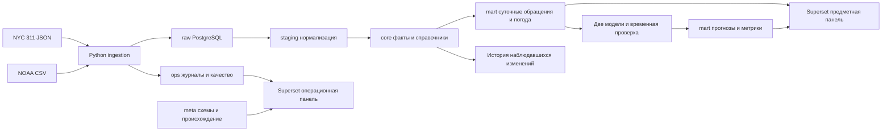

# Анализ и прогнозирование обращений граждан

Проект по дисциплине «Прогнозно-аналитические системы», профиль «Управление данными». Автор: Кудзиев Ш.Д., ИНБО-20-23. Преподаватель: Приходько Н.А.

Система получает обращения NYC 311 в JSON и погоду NOAA в CSV, сохраняет исходные записи в PostgreSQL, строит суточную витрину по категориям и Community Board, проверяет качество, сравнивает две модели и публикует семисуточный прогноз в Apache Superset.

## Быстрый запуск

1. Перейти по адресу `http://127.0.0.1:8088/superset/dashboard/pas-demand/`.
2. Войти с логином `admin`. Пароль показывает окно запуска. Он также хранится в локальном `.env`.
3. Операционный дашборд: `http://127.0.0.1:8088/superset/dashboard/pas-operations/`.


## Стек и требования

- python 3.11 в папке проекта, Apache Superset 6.0.0.
- PostgreSQL 18 из Postgres.app. По умолчанию бинарные файлы ищутся в `/Applications/Postgres.app/Contents/Versions/latest/bin`; другой путь задаётся `POSTGRES_BIN`.
- pandas 2.1.4, NumPy 1.26.4, scikit-learn 1.6.1, psycopg2. Полный список проверенных версий — `requirements.lock.txt`.
- Доступ к интернету для первоначальной установки и обновления открытых данных. Для просмотра уже рассчитанных данных интернет не нужен.
- Порты: PostgreSQL `127.0.0.1:55432`, Superset `127.0.0.1:8088`. База проекта хранится в `.state/postgres` и отделена от других баз пользователя.

```

Проект не содержит паролей в исходном коде. При новой установке `.env` создаётся со случайными значениями и правами `0600`. Его нельзя добавлять в Git. Не следует переносить `.state/postgres` между разными основными версиями PostgreSQL.

## Источники и охват

1. NYC Open Data, набор `erm2-nwe9`: https://data.cityofnewyork.us/resource/erm2-nwe9.json
2. NOAA NCEI Access Data Service, `daily-summaries`, станция `USW00094728` (Central Park): https://www.ncei.noaa.gov/access/services/data/v1

В конфигурации по умолчанию выбраны `HEAT/HOT WATER`, `Water System`, `Street Condition`, все доступные Community Board и округа. История начинается 01.01.2023. Текущие незавершённые дни не используются: конец загрузки отстоит на три дня от календарной даты Нью-Йорка. Это выборка выбранных категорий, а не все обращения города. Адреса, имена заявителей, координаты домов и свободные тексты не загружаются.

Контрольный запуск 15.11.2026: 1 639 872 обращения до 12.11.2026, 1 410 погодных наблюдений, 227 сочетаний категории и территориальной единицы, 320 524 строки суточной витрины. Справочник содержит также неопределённые и служебные территориальные значения, поэтому его размер не равен числу официальных районов Нью-Йорка.

Категория Water System не содержит новых записей после 29.07.2026. Причина не установлена. Она сохраняется для исторического анализа, но исключается из публикуемого прогноза правилом актуальности категорий. Нельзя трактовать отсутствие поступлений как доказанное отсутствие проблем водоснабжения. В погодном ряду отсутствуют минимальная/максимальная температура за два дня. 12 337 обращений имеют неопределённую либо нестандартную территориальную привязку. Эти значения видны как предупреждения и не подменяются вымышленными данными.

## Архитектура



`sql/` содержит последовательные миграции с контрольными суммами. Изменять уже применённую миграцию нельзя: для изменения схемы добавляется новый файл. Снимки схем внешних источников сохраняются в `meta.source_schema`. Исчезновение запрашиваемого столбца останавливает загрузку.

## Слои и ключи

| Объект | Зерно и назначение |
|---|---|
| raw.service_request | Одна запись на unique_key, выбранный исходный JSON, SHA-256, идентификатор загрузки |
| raw.weather | Станция и дата наблюдения, исходные CSV-поля в JSONB |
| staging.v_requests | Приведение регистра, пробелов и неопределённых значений |
| core.category | Уникальное нормализованное имя категории |
| core.district | Уникальная пара Community Board и Borough |
| core.service_request | Типизированный текущий факт, ссылки на справочники |
| core.request_history | Наблюдавшиеся версии обращения, valid_from и valid_to |
| mart.daily_requests | Дата, категория, район, количество и погода |
| mart.model_run / model_metric | Параметры, временные разбиения, выбор модели и ошибки |
| mart.prediction / backtest | Прогнозы и результаты проверки по отдельным сериям |
| ops.load_log / watermark | Журнал запуска и подтверждённая граница загрузки |
| ops.quality_result | Все результаты автоматизированных проверок |
| meta.lineage | Связь источника, преобразования, витрины и дашборда |

Созданная дата обращения имеет локальную семантику Нью-Йорка (`Floating Timestamp` в источнике). Суточное агрегирование сохраняет её календарную дату. Технические времена загрузки хранятся как `timestamptz`.

## Инкремент, идемпотентность и сбои

- История разбивается по месяцам и загружается страницами по 10 000 строк со стабильной сортировкой по дате и ключу. Предварительная загрузка сверяет число полученных строк с `COUNT` в источнике и сохраняет SHA-256 снимка.
- Уникальные ключи и upsert предотвращают дубли. Неизменившиеся строки не переписываются и не создают новую версию истории.
- Новые данные запрашиваются от watermark с перекрытием 14 суток для запоздавших обращений и исправлений. Это осознанное уточнение первоначальной схемы «строго после даты». Изменения более старых записей требуют принудительного повторного чтения соответствующего диапазона.
- Watermark не продвигается при неуспехе запуска. Успешные месячные фрагменты исторической загрузки можно использовать при повторном запуске. Ошибочный фрагмент не отмечается завершённым.
- HTTP 429, временные ошибки сервера и таймауты повторяются с возрастающей задержкой, до пяти попыток. Постоянные HTTP 400/401/403/404 немедленно завершают загрузку ошибкой.
- Некорректные записи сохраняются в карантине `ops.rejected_record`. Время, счётчики, параметры и ошибка запуска доступны в журнале.
- Блокировка файла исключает параллельный запуск двух конвейеров. При критической ошибке качества новый прогноз не публикуется. Последний полностью успешный прогноз остаётся доступным.

Перепроверка 15 последних суток после первого запуска получила 17 329 обращений и 15 погодных строк. Добавлено 0, изменено 0, отклонено 0. В raw осталось 1 639 872 уникальных обращения. Контролируемый тест недоступности источника создал запись FAILED, сохранив прежний watermark.

## Прогноз и проверка моделей

`SeasonalNaive7` повторяет значение того же дня предыдущей недели. `RidgeDirect7` обучает отдельную регрессию для каждого из семи горизонтов. Цель преобразуется через `log1p`; прогноз возвращается через `expm1` и ограничивается снизу нулём. Признаки: предыдущие значения обращений, среднее и стандартное отклонение за 7 и 28 дней, день недели и месяц целевой даты, годовой календарный цикл, тренд, категория и район. Погода используется только с задержкой 7 дней. Фактическая погода будущего дня не используется.

Предобработка и обучение выполняются заново внутри каждого временного разбиения. Ни один обучающий target не выходит за дату начала прогнозирования. Шесть последовательных недель с 04.09 по 15.10.2026 используются для валидации. Затем проводится отдельный тест из четырёх недель с 16.10 по 12.11.2026 с еженедельным расширением доступной истории. Тест не используется для выбора модели. Все разбиения и прогнозы сохранены в PostgreSQL.

Модель выбирается по минимальному среднему WAPE шести валидационных недель на уровне «категория × район × сутки». Параметр регуляризации Ridge равен 20 и зафиксирован до итогового теста. Выбрана SeasonalNaive7. Таблица содержит средние метрики по недельным окнам, а не ошибку одного объединённого окна.

| Период | Модель | MAE на серию, обращений/сутки | RMSE | WAPE, % |
|---|---|---:|---:|---:|
| Валидация | SeasonalNaive7 | 1,691 | 3,734 | 75,851 |
| Валидация | RidgeDirect7 | 1,862 | 3,522 | 83,994 |
| Итоговый тест | SeasonalNaive7 | 4,650 | 11,488 | 76,006 |
| Итоговый тест | RidgeDirect7 | 4,693 | 11,124 | 75,286 |

MAE измеряется в обращениях на серию в сутки. WAPE — сумма абсолютных ошибок, делённая на сумму фактических обращений, в процентах. При нулевой сумме факта WAPE не вычисляется. На уровне суммарной нагрузки города метрики другие: агрегирование частично компенсирует разнонаправленные ошибки районов.

Прогноз на 13–19.11.2026 для двух актуальных категорий выбранной модели составляет 9 921 обращение за неделю. Для Manhattan — 2 303. Это оценка учебного прототипа с существенной ошибкой, особенно при резких изменениях отопительной нагрузки. Модель не подтверждает готовность к автоматическому распределению персонала без решения аналитика. Нынешний исторический срез может содержать позднейшие исправления источника; полностью восстановить состояние данных на каждую прошлую дату невозможно.

## Контроль качества и происхождение

Реализованы 17 проверок: полнота, уникальность, тип, допустимые значения, диапазон, ссылочная целостность, актуальность и сверка агрегатов. Контрольный результат: 14 PASS, 3 WARN, 0 FAIL. Предупреждения касаются двух погодных дат, 12 337 территориальных значений и категории Water System. Температурные пропуски заполняются медианой обучающей выборки только внутри модели. В исходной витрине они остаются NULL.

Чтобы показать происхождение показателя «Обращения», открыть таблицу lineage на операционном дашборде и пройти цепочку: предметная панель → `mart.v_daily_requests` → `mart.daily_requests` → `core.service_request` → `staging.v_requests` → `raw.service_request` → NYC Open Data. Идентификаторы загрузок сохраняются на raw- и core-записях. История фиксирует только изменения, реально наблюдавшиеся после начала работы системы.

## Тесты и воспроизведение результатов

```sh
.venv/bin/python -m pytest tests -q
.venv/bin/python -m src.pipeline --skip-download
```

Тесты проверяют повтор HTTP, отказ без продвижения watermark, upsert без дублей, создание двух наблюдавшихся версий при контролируемом изменении, неотрицательность прогноза и отсутствие использования будущих целей/погоды. Тестовые записи историзации откатываются транзакцией. Запись FAILED с `load_mode=fault_injection` в журнале — результат намеренного испытания.

`data/exports/verification.json` содержит результаты сверок. `model_summary.json` — параметры и метрики. `forecast.csv` — прогноз по всем рассчитанным сериям и обеим моделям; публикуемый прогноз дополнительно проходит фильтр актуальности категорий. `docs/screenshots/` содержит снимки работающего интерфейса.

## Автоматизация

Полный цикл выполняется одной командой `.venv/bin/python -m src.pipeline`. Ручного копирования исходных файлов не требуется. Эту команду можно запускать из macOS launchd или другого планировщика с рабочей папкой проекта и уже включённым PostgreSQL. Постоянный автозапуск и ежедневное расписание на пользовательском Mac по умолчанию не включены.

Дашборды получают данные непосредственно из PostgreSQL. Кэш запроса хранится 60 секунд; периодическое обновление панели настроено на 300 секунд. Пересоздавать диаграммы после очередной загрузки не нужно. Подключение BI имеет права только чтения на опубликованные схемы.

## Ограничения и дальнейшая работа

- Выборка ограничена тремя категориями и одной метеостанцией. Central Park не отражает все локальные различия погоды.
- Новые обращения и исправления вне 14-дневного окна могут быть пропущены до явной перезагрузки старого диапазона. Полного CDC от источника нет.
- Снимки не дают полной истории состояния источника до начала наблюдений. Удаление записи на стороне источника автоматически не обнаруживается.
- Water System требует проверки изменений классификатора. Автоматическое объединение с похожими названиями без подтверждения не выполняется.
- Высокая относительная ошибка на малых районных рядах и переход отопительного сезона ограничивают практическую точность.
- Распределение нагрузки, неопределённость прогноза и эксплуатация несколькими пользователями требуют отдельной доработки. Прототип слушает только локальный адрес и предназначен для учебной демонстрации.

## Документация технологий

- SODA API: https://dev.socrata.com/docs/queries/
- NOAA API: https://www.ncei.noaa.gov/support/access-data-service-api-user-documentation
- PostgreSQL: https://www.postgresql.org/docs/18/
- Superset: https://superset.apache.org/admin-docs/installation/pypi/
- Ridge: https://scikit-learn.org/stable/modules/generated/sklearn.linear_model.Ridge.html

## Структура проекта

`src/` — загрузка, обработка и контроль качества, модели, создание дашбордов, конвейер. `sql/` — миграции. `config/` — параметры источников и Superset. `scripts/` — установка и управление службами. `tests/` — модульные и интеграционные проверки. `data/exports/` — вычисленные результаты. `data/cache/` — снимки открытых источников, исключены из Git. `.state/` — локальная база и журналы, исключены из Git. `.venv/` и `.runtime/` — локальное окружение, исключено из Git.
